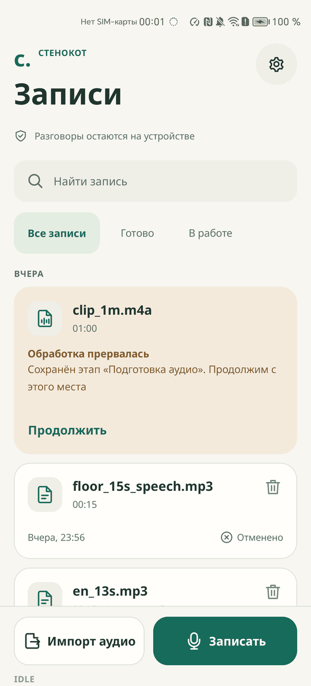
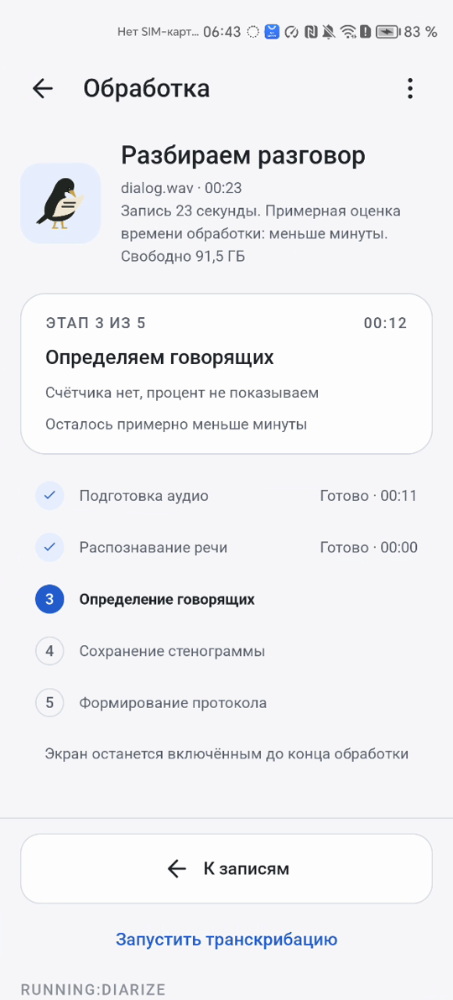
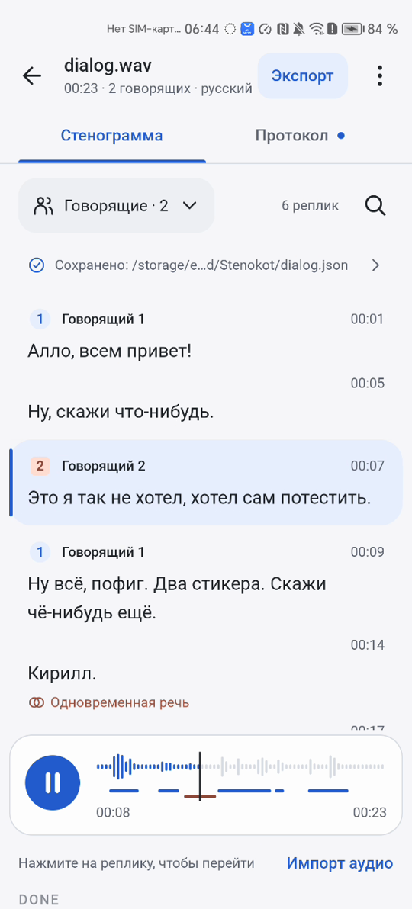
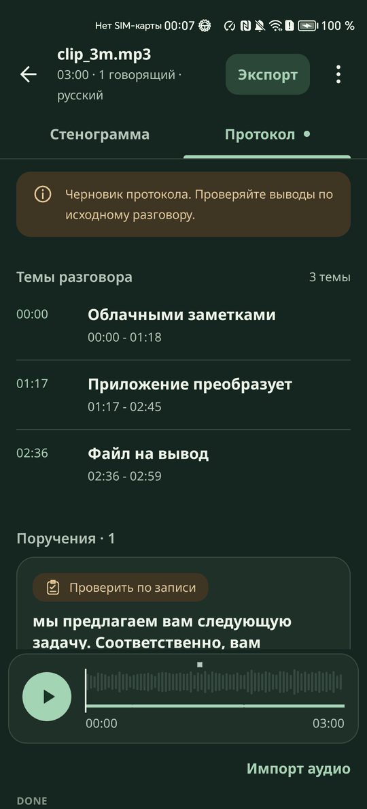

<p align="center">
  
</p>

<h1 align="center">Сквор</h1>

<p align="center">
  Расшифровка разговоров на Android без сети: дословный текст, говорящие, временные метки, файл JSON и протокол со ссылками на реплики
</p>

Кейс «Нейро-стенографист», Nuclear IT Hack 2026, Hex.team.

<p align="center">
  
  
  
  
</p>

## Отчётные материалы

| Что требуется | Где |
|---|---|
| 1. APK-файл | [Releases](https://github.com/jfghmrr/NuclearItHack/releases), ссылка и SHA-256 в «Быстром старте» |
| 2. Исходный код | [src/](src/README.md): Android-проект, модули `:app`, `:core`, `:engine-llm`; сборка из чистого клона в [CI](.github/workflows/release.yml) |
| 3. Установка и использование | [Быстрый старт](#быстрый-старт) и [Сценарий проверки](#сценарий-проверки) ниже, [протокол обмена](docs/PROTOCOL.md), раздел «Помощь» в самом приложении |
| 4. Архитектура и модели | [docs/ARCHITECTURE.md](docs/ARCHITECTURE.md), раздел [Модели](#модели) |
| 5. Ограничения | [docs/LIMITATIONS.md](docs/LIMITATIONS.md), раздел [Ограничения](#ограничения) |
| 6. Результаты собственных тестов | [docs/TEST_RESULTS.md](docs/TEST_RESULTS.md), [artifacts/test-results/](artifacts/test-results/README.md) |
| 7. Видеодемонстрация | [artifacts/demo/skvor_demo_honor.mp4](artifacts/demo/skvor_demo_honor.mp4), 110 с, Honor, сборка 1.1.0; описание в [artifacts/demo/](artifacts/demo/README.md) |

## Команда

| Участник | Роль | GitHub |
|---|---|---|
| Ильин Кирилл | Разработка | [@coder-smookki](https://github.com/coder-smookki) |
| Васильева Арина | Дизайн | [@jfghmrr](https://github.com/jfghmrr) |
| Акбулатов Шамиль | Тестирование | [@roflanzombik](https://github.com/roflanzombik) |

## Быстрый старт

Нужно устройство или эмулятор на Android 10 и новее с архитектурой `arm64-v8a`. APK один, все модели внутри него, сеть не нужна.

Дайте эмулятору загрузиться до конца: после первого запуска система ещё 3-5 минут занята службами Google. На нашем чистом эмуляторе установка в эти минуты дважды обрывалась перезапуском системного процесса, а после затихания проходила за 8-120 с. APK весит 1,35 ГБ и требует около 3,2 ГБ свободного места, на чистом эмуляторе по умолчанию свободно 5,0 ГБ. Если `adb` сообщил ошибку, подождите минуту и повторите установку.

**Скачать:** [Сквор 1.1.0](https://github.com/jfghmrr/NuclearItHack/releases/tag/v1.1.0), файл `skvor-6968155.apk`, 1,35 ГБ, подписан ключом команды.
SHA-256: `82bcb205b91d97bc837e114f7ddb860c77bd910cf870b923e0ddae7b6ae23ff2`

APK собирает GitHub Actions по тегу `v*` ([.github/workflows/release.yml](.github/workflows/release.yml)): сборка из чистого клона, тесты, проверка разрешений, публикация в [Releases](https://github.com/jfghmrr/NuclearItHack/releases) с SHA-256 в описании релиза.

```sh
adb install -r -g skvor-<commit>.apk
adb push dialog1.mp3 /sdcard/Download/
adb shell am start -a android.intent.action.VIEW -t audio/mpeg \
  -d file:///sdcard/Download/dialog1.mp3 -p ru.skvor.app
```

Результат появится в `/sdcard/Download/Skvor/dialog1.json`. Вручную то же делает кнопка «Импорт аудио»: файл выбирается в системном окне, обработка стартует сама. Статусы для автоматики и идентификаторы элементов описаны в.

Сборка из исходников:

```sh
git clone --recurse-submodules https://github.com/jfghmrr/NuclearItHack.git
cd NuclearItHack
./scripts/fetch_models.sh
cd src/mobile/android
echo "sdk.dir=$ANDROID_HOME" > local.properties
./gradlew :app:assembleFullRelease
```

Нужны JDK 21, Android SDK 36, NDK 28.2.13676358 и 29.0.13113456, CMake 3.31.6. Подробно в [src/README.md](src/README.md).

## Что делает

Запись совещания, созвона или интервью часто нельзя отдавать в облачный сервис. Сквор делает всё на телефоне: у приложения нет разрешения `INTERNET`, модели лежат внутри APK.

1. Приложение открывается на библиотеке записей без запросов разрешений. При самом первом обычном запуске показывается короткое знакомство из четырёх экранов с кнопками «Пропустить» и «Импорт аудио». Запуск с файлом через `VIEW` или «Поделиться» знакомство не показывает никогда, обработка начинается сразу
2. «Импорт аудио» открывает системное окно выбора в папке `Download`. Файл можно открыть и из другого приложения. Рядом кнопка «Записать» для записи с микрофона
3. Обработка стартует сама. До загрузки моделей файл проверяется: формат, дорожка, декодер, свободное место
4. Экран обработки показывает пять этапов, реальный счётчик фрагментов или окон, процент этапа и прошедшее время
5. JSON проверяется по байтам и сохраняется в `Download/Skvor/<имя>.json`, экран показывает итог «Результат готов»
6. Через 3 секунды в отдельном процессе локальная языковая модель Qwen3-0.6B строит темы разговора и протокол. JSON от этого шага уже не зависит
7. На результате: реплики, плеер с огибающей и дорожками говорящих, поиск, фильтр по говорящему, правка текста и говорящего реплики, протокол с переходом к реплике, экспорт

Формат файла строго по заданию:

```json
{"transcript":[{"speaker_id":"speaker_1","start_ms":1250,"end_ms":4380,"text":"Добрый день!"}]}
```

## Результаты

Все числа измерены нами, у каждого указаны устройство, сборка и дата. Методика и полные таблицы в [docs/TEST_RESULTS.md](docs/TEST_RESULTS.md).

**Скорость на телефоне.** Honor NTN-LX1, Snapdragon 662, полный APK с коммита `74bea98`, MP3 через `VIEW`, 2026-11-07. `RTF_core` - время от приёма файла до сохранённого JSON, делённое на длительность записи.

| Запись | Время до JSON | `RTF_core` |
|---|---:|---:|
| Русская, 30 с | 26 с | 0,74 |
| Русская, 3 мин | 88 с | 0,47 |
| Русская, 6:22 | 221 с | 0,58 |
| Английская, 3 мин | 109 с | 0,60 |
| Русская, 57 мин | 3695 с | 1,075 |

Время до JSON взято внешним таймером от отправки файла, `RTF_core` из `metadata.json`. Пик памяти 0,62-0,93 ГБ на русских записях и 1,41 ГБ на английских.

На чистом эмуляторе arm64 с 4 ГБ RAM русская запись на 3 минуты в холодном процессе дала JSON за 36 с, `RTF_core` 0,19, пик 0,64 ГБ. Установка APK там заняла 120 с.

Итоговая сборка `8016be2` на том же Honor, 2026-11-08: русская запись на 3 минуты 89 с, на 6:22 226 с, английская на 3 минуты 114 с, то есть в пределах разброса прежних замеров. На чистом эмуляторе подряд, как при проверке: 30 с за 7 с, 3 минуты за 54 с, английские 13 с за 9 с, снова 30 с за 8 с, без падений.

На Honor с балластом 1,9 ГБ в памяти телефона русская запись на 3 минуты дала тот же JSON байт в байт за 88 с, без предупреждений и без остановок процесса. Часовая запись на этом телефоне медленнее реального времени: две трети времени ушло на определение говорящих.

**Качество.** Внутренние наборы, оценка организаторов может отличаться.

| Что | Значение | Условия |
|---|---|---|
| DER, collar 0,25 с | 10,07 | Приложение на эмуляторе, 49 размеченных файлов, 259 минут, перекрытия учитываются |
| DER, collar 0 | 16,46 | То же |
| Точное число говорящих | 32 из 49 | То же |
| WER, русский подкаст | 7,01 | GigaAM v3 e2e, 33 минуты, 4867 слов, стенд на Mac с теми же нарезкой и громкостью, что в приложении |
| WER, тот же подкаст под шумом 5 дБ | 8,86 | То же |
| WER, английский | 16,84 | Parakeet TDT 0.6B v2, 104 файла |

Из 49 файлов с разметкой говорящих только 15 русские: размеченных русских подкастов у нас нет. DER измерен на эмуляторе с входом WAV. «Стенд» дальше означает наш набор скриптов на Mac: те же модели и sherpa-onnx 2.0.1, та же нарезка, громкость и поиск речи, что в приложении, но без Android.

## Соответствие уровням задания

Уровни Basic, Medium и Ultra взяты из описания кейса. В последнем столбце только то, что мы измерили, пустая клетка значит, что отдельного замера нет.

| Уровень | Требование | Как сделано | Что измерено |
|---|---|---|---|
| Basic | Работа на Android без сети | Нет `INTERNET` и `ACCESS_NETWORK_STATE`, модели в APK | CI отклоняет APK с сетевыми разрешениями, прогоны в авиарежиме |
| Basic | Импорт аудио | Системный выбор, «Открыть с помощью», «Поделиться», MP3, WAV, M4A, OGG, FLAC | MP3 через `VIEW` на эмуляторе и Honor, системный выбор на эмуляторе |
| Basic | Речь в текст | GigaAM v3 e2e для русского, Parakeet TDT 0.6B v2 для английского | WER выше |
| Basic | Говорящие и временные метки | Сегментация pyannote, отпечатки TitaNet, книга говорящих, уточнение по фразам | DER выше |
| Basic | Показ и экспорт | Экран результата, автоматический JSON, экспорт JSON и протокола | Файл проверяется валидатором по байтам |
| Medium | Предобработка звука | Громкость к -23 дБFS при чтении, моно 16 кГц | |
| Medium | Фильтр пауз и неречевых участков | Silero VAD режет запись и пропускает паузы от 2 с | |
| Medium | Устойчивые номера говорящих | Окна по 5 минут сшиваются книгой говорящих, затем говорящие пересобираются по целым фразам | Сдвиг DER файла от неслышного шума в 1 младший бит: 1,84 до 0,72 пункта в среднем, стенд, 53 файла |
| Medium | Пунктуация | Из модели распознавания, которая слышит интонацию | Входит в WER выше |
| Medium | Прогресс | Пять этапов, реальные счётчики, оценка по замерам устройства | Проверка вёрстки, раздел «Интерфейс» в [TEST_RESULTS](docs/TEST_RESULTS.md) |
| Medium | Плеер с переходом к реплике | Media3, общий файл `pcm16k.wav`, огибающая и дорожки говорящих | |
| Ultra | Шум и музыка | Громкость выравнивается, паузы под музыкой и шумом не распознаются заново. Шумоподавитель и фильтр высоких частот проверены и отклонены: они ухудшали говорящих | WER подкаста под шумом 5 дБ 8,86, под музыкой 9,70. DER на 29 файлах с шумом или музыкой 5 дБ 7,91. Язык под шумом и музыкой: 18 из 18 русских, 17 из 18 английских. Всё на стенде |
| Ultra | Короткие реплики и перебивания | Короткая реплика с другим голосом не поглощается, реплика после тире не сливается с соседней. На русском маршруте тихие ответы в паузах между словами распознаются заново | WER на 8 наборах с перебиваниями 15,09, стенд |
| Ultra | Одновременная речь | Реплики разных говорящих могут пересекаться по времени. Текст двух голосов не разделяется | DER считается с перекрытиями |
| Ultra | Оптимизация памяти | Стадии строго по очереди, модель стадии закрывается до следующей, диаризация окнами | Пик 0,9 ГБ на 57 минутах на Honor |
| Ultra | Аппаратное ускорение | Не сделано: только CPU | |
| Ultra | Редактирование | Долгое нажатие на реплику: «Изменить текст», «Сменить говорящего», «Вернуть исходный». Машинный результат хранится отдельно, правки лежат в `edits.json` и сразу переписывают `Download/Skvor/<имя>.json` после проверки валидатором. Время и число реплик не меняются, номера говорящих пересчитываются по первому появлению | Эмулятор: правка текста и смены говорящего дают валидный JSON с прежними метками времени, «Вернуть исходный» возвращает файл байт в байт. Без правок JSON не меняется, 8 модульных тестов |

## Что мы считаем уникальным

Офлайн, модели на устройстве и контракт JSON здесь не перечислены: это условия задачи. Ниже только то, что есть в коде на `main` и проверено.

- Файл раньше модели: JSON проверяется по реальным байтам и записывается до запуска языковой модели. Статус `DONE` появляется последним, когда протокол и служебные данные уже опубликованы
- Проверяемый протокол: модель выбирает только вид пункта и номер реплики. Грамматика не даёт сослаться на несуществующую реплику, текст, говорящего и время копирует код
- Говорящие из целых фраз: после распознавания каждая фраза получает отпечаток голоса, и говорящие собираются заново. На 49 файлах приложение: DER 18,62 до 10,07 вместе с исправлением языка, точное число говорящих 24 до 32
- Язык по алфавиту: пробные фрагменты голосуют кириллицей и латиницей, а почти пустой текст проверяется английской моделью. Русский файл не платит за это ничего
- Слияние без потери слов: разрез только между словами, текст слова не меняется. Это проверяют случайные тесты, в том числе 300 случаев уточнения говорящих через настоящие слияние и валидатор
- Продолжение с места остановки: чекпойнт после каждого фрагмента распознавания и каждого окна диаризации
- Длинные записи окнами: запись на 57 минут прошла на Honor и на эмуляторе, пик памяти вырос на 8 % при записи в 10 раз длиннее
- Плеер с лентой говорящих: огибающая записи считается один раз, под ней дорожки говорящих и отметки протокола
- Доказательства на устройстве: разрешения проверяются по установленному пакету, файлы моделей сверяются с SHA-256 сборки по кнопке, у каждого прогона есть замеры
- Ошибки с одним действием: фраза, причина и одна главная кнопка, код спрятан в «Подробнее»
- Проверенная вёрстка: 715 снимков на 360x800, 320x568, 800x1280 и Honor, светлая и тёмная тема: 0 наложений, 0 обрезанных подписей

## Как устроено

```text
Импорт: системный выбор, VIEW, SEND, запись с микрофона
  |
  v
Основной процесс, стадии строго по очереди
  IMPORT    копия файла и предпроверка, модели ещё не загружены
  DECODE    MediaCodec -> pcm16k.wav, 16 кГц, моно
  VAD       Silero -> фрагменты до 22 с
  LANG_ID   пробные фрагменты, русский или английский маршрут
  ASR       GigaAM v3 e2e или Parakeet TDT 0.6B v2, журнал asr.jsonl
  DIARIZE   окна по 5 минут, книга говорящих, уточнение по фразам
  MERGE     слова -> говорящие -> реплики
  VALIDATE  проверка реальных байтов JSON
  |
  +---> Download/Skvor/<имя>.json      txt_status: TRANSCRIPT_READY
  |
  v  пауза 3 с
Процесс :llm
  LLM       Qwen3-0.6B, llama.cpp, грамматика GBNF
  |
  +---> Download/Skvor/meta/<имя>.protocol.json, <имя>.metadata.json
  v
DONE
```

| Компонент | Что делает |
|---|---|
| `:core` | Чистый Kotlin без Android: контракт и валидатор, слияние, фрагменты, книга говорящих и уточнение по фразам, определение языка, окна и пределы языковой модели, протокол, состояния. Тесты на JVM |
| `:app` | Интерфейс Compose, очередь и стадии, служба обработки, запись с микрофона, хранилище задач, декодер, обёртки движков |
| `:engine-llm` | Сборка llama.cpp и мост JNI: загрузка, генерация по грамматике, отмена |
| Процесс `:llm` | Только языковая модель. Его смерть возвращает память и не задевает интерфейс и JSON |

Подробно в [docs/ARCHITECTURE.md](docs/ARCHITECTURE.md).

## Модели

| Назначение | Модель | Размер | Лицензия |
|---|---|---:|---|
| Распознавание, русский | GigaAM v3 e2e RNNT int8 | 221,2 МиБ | MIT |
| Распознавание, английский | Parakeet TDT 0.6B v2 int8 | 630,7 МиБ | CC-BY-4.0 |
| Поиск речи | Silero VAD | 0,6 МиБ | MIT |
| Сегментация говорящих | pyannote segmentation 3.0 int8 | 1,5 МиБ | MIT |
| Отпечатки голоса | TitaNet small | 38,4 МиБ | Apache-2.0 |
| Темы и протокол | Qwen3-0.6B Q4_K_M | 378,3 МиБ | Apache-2.0 |

Всего 1270,7 МиБ. APK, который мерили на Honor, весит около 1,35 ГБ. Модели не дообучались.

## Данные и приватность

| Что | Где | Кому видно |
|---|---|---|
| Контрактный JSON | `Download/Skvor/<имя>.json` | Общая память устройства |
| Протокол и замеры | `Download/Skvor/meta/<имя>.protocol.json`, `<имя>.metadata.json` | Общая память устройства |
| Копия файла, `pcm16k.wav`, журналы стадий | `filesDir/jobs/<uuid>/` | Только приложение |
| Копия языковой модели | `noBackupFilesDir/models/` | Только приложение |

В `metadata.json` лежат версии, SHA-256 моделей, исходного файла и JSON, времена стадий, пик памяти и счётчики токенов. Текста реплик и звука там нет. Резервное копирование отключено. Внешний адрес `file://` внутрь закрытых каталогов приложения и адрес `content://` его собственного провайдера отклоняются до обработки. Подробно в. Тестовых записей в репозитории нет.

## Сценарий проверки

Перед началом: APK установлен, в `Download` лежит запись разговора `dialog1.mp3`.

1. Запустите приложение: открывается «Записи», `txt_status` показывает `IDLE`
2. Нажмите «Импорт аудио» и выберите `dialog1.mp3`: открывается «Обработка» с именем, длительностью, оценкой времени и свободным местом
3. Смотрите на рельс этапов: «Подготовка аудио», «Распознавание речи», «Определение говорящих», «Сохранение стенограммы», «Формирование протокола». У текущего этапа «Этап N из 5», процент и счётчик, `txt_status` показывает `RUNNING:<STAGE>`
4. После сохранения появляется «Результат готов», `txt_status` показывает `TRANSCRIPT_READY`, внизу путь к файлу
5. Выполните `adb pull /sdcard/Download/Skvor/dialog1.json`: в файле только ключ `transcript`, у записей поля `speaker_id`, `start_ms`, `end_ms`, `text`
6. Нажмите «Открыть стенограмму» и дождитесь `DONE`
7. Нажмите реплику: плеер перематывается на её начало
8. Откройте вкладку «Протокол» и нажмите пункт: виден источник, «Перейти к реплике» открывает реплику в стенограмме
9. Найдите слово через поиск и выберите говорящего в «Говорящие · N»: остаются только подходящие реплики
10. Нажмите «Экспорт»: открывается системное окно сохранения `dialog1.json`. Через ⋮ и «Экспорт результата» можно выбрать «Данные расшифровки» или «Протокол»

## Ограничения

Полный список в [docs/LIMITATIONS.md](docs/LIMITATIONS.md). Главное:

- Тихий дальний собеседник и очень короткие ответы - слабое место. На восьми записях владельца на Honor в трёх из пяти разговоров двух-трёх человек найден один говорящий или на одного меньше
- Запись, где смешаны русский и английский, идёт одной моделью: вторая часть теряется
- При 5-8 говорящих число угадано в 6 из 13 файлов, при 9-21 говорящих в 2 из 5
- Длинная запись на слабом телефоне идёт медленнее реального времени: 57 минут обрабатывались около 62 минут на Snapdragon 662
- Пути для записей на 8 часов и 5 ГБ есть в коде, но полностью не прогонялись. Самый длинный прогон - 57 минут
- Только CPU и `arm64-v8a`, интерфейс только на русском
- Протокол строит модель на 0,6 млрд параметров, поэтому он помечен как черновик и пунктов в нём мало

## Документация

| Документ | О чём |
|---|---|
| [docs/ARCHITECTURE.md](docs/ARCHITECTURE.md) | Компоненты, решения, состояния, инварианты |
| | Запуск без участия человека, статусы и идентификаторы |
| [docs/TEST_RESULTS.md](docs/TEST_RESULTS.md) | Методика, замеры скорости, памяти и качества |
| [docs/LIMITATIONS.md](docs/LIMITATIONS.md) | Ограничения и риски |
| | Модели, источники, лицензии, хэши |
| | Приватность и разрешения |
| [src/README.md](src/README.md) | Сборка из чистого клона и CI |
