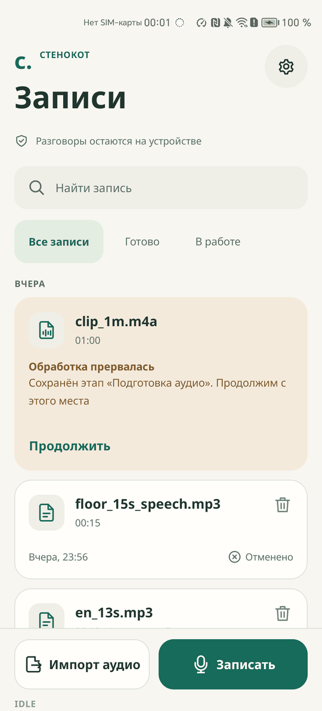
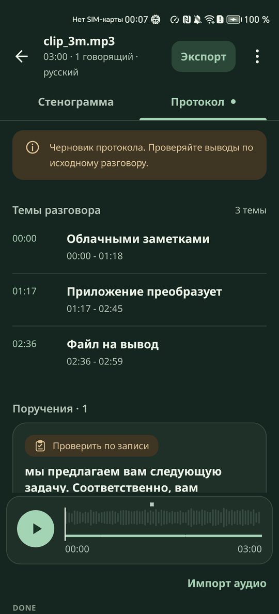

# Брендбук

Спокойный инструмент для чтения проверенного документа: тёплая бумага, тёмно-зелёные чернила, один глубокий зелёный акцент, крупная типографика и много воздуха. Интерфейс не должен выглядеть ни стандартным шаблоном, ни панелью показателей.

  
  

## Имя

| | |
|---|---|
| Название | Стенокот |
| Обещание | Разговоры остаются на устройстве |
| Пакет | `ru.stenokot.app` |
| Папка вывода | `Download/Stenokot/` |

## Цвета

Все цвета заданы токенами в `ui/theme/Tokens.kt`, литералов на экранах нет. Тема по умолчанию следует за системной, её можно выбрать в «Настройках».

| Токен | Светлая | Тёмная | Где |
|---|---|---|---|
| `primary` | `#176B5B` | `#A3D4B4` | Главная кнопка, активная вкладка, полоса прогресса |
| `onPrimary` | `#FFFFFF` | `#173825` | Текст на `primary` |
| `primaryContainer` | `#E4EDE1` | `#2A4737` | Кнопка «Экспорт», активный фильтр |
| `background` | `#F7F6F1` | `#15251F` | Фон приложения |
| `surface` | `#FFFEFA` | `#1E3028` | Карточки и листы |
| `onSurface` | `#21352F` | `#EEF3E9` | Основной текст |
| `onSurfaceVariant` | `#5D6D64` | `#B4C3B7` | Вторичный текст, время |
| `outlineVariant` | `#DDE3D9` | `#374A3F` | Разделители и рамки |
| `success` | `#27674B` | `#A2D3B5` | Готово |
| `warning` | `#855A27` | `#E8C58D` | Пауза, черновик, частичный протокол |
| `error` | `#AE4938` | `#F6B5A2` | JSON или файл экспорта не получен |
| `recording` | `#BD5742` | `#BD5742` | Идёт запись |

Правила:

- Красный только для настоящей беды: JSON или файл экспорта не получен. Сбой протокола показывается предупреждением
- Отмена не ошибка и красным не красится
- Цвет никогда не работает один: рядом всегда значок, слово, номер или форма

## Шрифт

Noto Sans, встроен в приложение, лицензия OFL: сети у приложения нет. Время и счётчики набираются цифрами одной ширины, поэтому строки не прыгают. Размеры задаются в sp и растут вместе со шрифтом устройства.

Форматы: время `00:04`, от часа `1:24:07`, диапазон `00:04 - 00:09`, дробь с запятой `11,7 МиБ`, размеры файлов и моделей в МиБ.

## Говорящие

Говорящий различается номером, формой значка и цветом. Подпись «Говорящий N» всегда написана обычным текстом.

| `speaker_id` | Форма | Заливка | Цифра и линии, светлая | Линии, тёмная |
|---|---|---|---|---|
| `speaker_1` | круг | `#E4EDE1` | `#236849` | `#A2D3B5` |
| `speaker_2` | скруглённый квадрат | `#F1E1D1` | `#8D4A28` | `#F0A878` |
| `speaker_3` | ромб | `#EBE2F0` | `#745290` | `#C2ACF2` |
| `speaker_4` | шестиугольник | `#DFEAF5` | `#355E84` | `#9CC2F5` |
| `speaker_5` | пятиугольник | `#F5E0EA` | `#8D4265` | `#F2A0CE` |
| `speaker_6` | арка | `#D9EDEE` | `#1F6A70` | `#63D2CE` |
| `speaker_7` | щит | `#EFECCF` | `#66601C` | `#CDCB66` |
| `speaker_8` | параллелограмм | `#E6E9ED` | `#56606C` | `#B4BEC8` |

Цвет идёт по кругу, а на каждом новом круге форма сдвигается на одну, поэтому пара цвет и форма не повторяется у первых 64 говорящих. Номер остаётся настоящим всегда. На ленте плеера каждый говорящий занимает свою горизонталь и отличается положением даже без цвета.

## Маскот

Стенокот: рыжий кот с блокнотом стенографиста и карандашом. Плоская иллюстрация, простые формы, спокойное выражение, без текста на изображении. Изображение для документов: [stenokot.png](stenokot.png).

| Поза | Где |
|---|---|
| `mascot_empty` | Пустая библиотека |
| `mascot_waiting` | Обработка, ожидание протокола |
| `mascot_done` | Итог «Всё по полочкам.» |
| `mascot_no_speech` | Речи не найдено |
| `mascot_file_error` | Неподдерживаемый или повреждённый файл |
| `mascot_storage` | Мало места |
| `mascot_memory` | Не хватило памяти |
| `mascot_interrupted` | Обработка прервалась |

Маскот стоит на круглой подложке, декоративен, и TalkBack его не озвучивает. Недоступная модель и ошибка обработки показываются ясным значком, без кота. В тёмной теме работает отдельный вариант с кремовой обводкой.

## Форма и движение

- Радиусы от 4 до 27 dp: карточки 18 dp, листы 27 dp. Глубина создаётся тоном, тонкие рамки вместо теней
- Нет декоративных градиентов, стекла и размытия
- 63 векторных значка из одного набора на сетке 24 dp
- Появление экрана однократное, 240 мс
- Единственное повторяющееся движение - «дыхание» маскота на экране обработки, цикл 2,4 с. Оно идёт только пока экран виден, меняется таймером, а не каждый кадр, и выключается «Анимациями маскота» в настройках и системным отключением анимации

## Тон интерфейса

- Каждый экран отвечает на три вопроса: где я, что происходит, что делать дальше
- Одно главное действие на экран, подпись словами
- Простой русский, технические имена только в диагностике
- Только правда: нет придуманных процентов, оценка времени показывается, только когда её есть чем подтвердить
- Ошибка - это понятная фраза, причина и одно действие

| Ситуация | Текст |
|---|---|
| Пустая библиотека | Слушайте. Остальное запишем. |
| Обработка | Стенокот слушает. |
| Итог | Всё по полочкам. |
| Повторный запуск | Обработка уже идёт. Повторный запуск не нужен |
| Без счётчика | Счётчика нет, процент не показываем |
| Сбой протокола | Стенограмма готова, протокол не создан |
| Перегрев | Пауза: устройство перегрелось |
