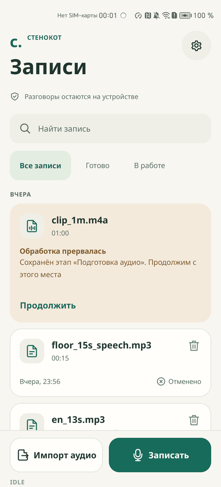
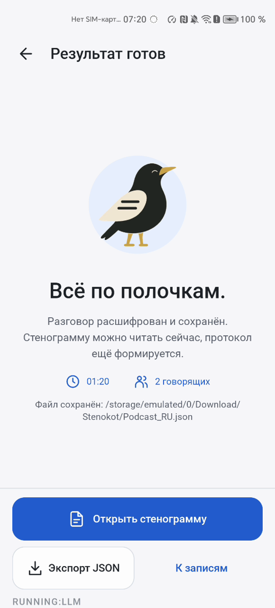
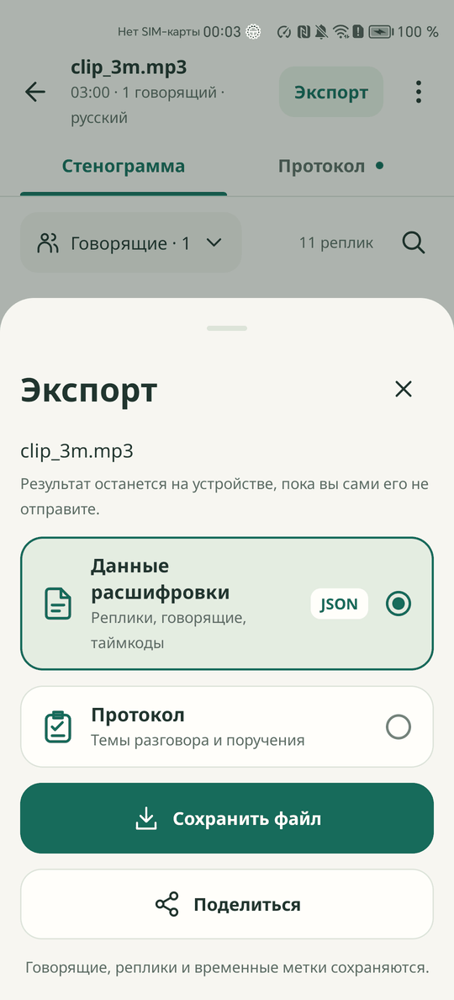

# Маршрут проверки

Файлы этой папки описывают возможности Сквора по порядку, с 01 до 19. Каждый начинается с того состояния, в котором его оставили предыдущие, а в разделе «Как проверить» перечислены шаги с ожидаемым результатом. Шаги сверены с кодом на `main`. Какие из них прогонялись на устройстве, сказано в [TEST_RESULTS.md](../TEST_RESULTS.md).

<p align="center">
  
  
  
</p>

## Что понадобится

- Устройство или эмулятор на Android 10 и новее с архитектурой `arm64-v8a`. Целевая среда - эмулятор ARM с 4 ГБ RAM
- `adb` и `aapt2` из Android SDK, для подготовки файлов `ffmpeg`, для проверки JSON `python3`
- Установленный APK: `adb install -r -g stenokot-<commit>.apk`. Как собрать, описано в [src/README.md](../../src/README.md)
- Своя запись разговора на 1-3 минуты с двумя говорящими: `dialog1.mp3`. Тестовых записей в репозитории нет
- Английская запись `english.mp3` и запись от 15 минут `long.mp3`
- Файлы для ошибок:

```sh
ffmpeg -f lavfi -i anullsrc=r=16000:cl=mono -t 30 silence.wav
head -c 200000 /dev/urandom > broken.mp3
echo hello > note.txt
adb push dialog1.mp3 english.mp3 long.mp3 silence.wav broken.mp3 note.txt /sdcard/Download/
```

Файл 14 завершает процесс приложения, файл 15 требует нехватки места, поэтому их лучше проходить после остальных проверок результата. Для прогона без интерфейса подходит [AUTOMATION.md](../AUTOMATION.md).

## Вход

- [01. Импорт аудио и запись](01-import.md)
- [02. Предпроверка файла](02-preflight.md)

## Обработка

- [03. Экран обработки](03-processing.md)
- [04. Библиотека и очередь](04-queue.md)

## От звука к стенограмме

- [05. Распознавание речи](05-recognition.md)
- [06. Определение говорящих](06-speakers.md)
- [07. Слияние слов и говорящих](07-merge.md)
- [08. Файл JSON](08-json.md)

## Результат

- [09. Стенограмма](09-transcript.md)
- [10. Плеер и лента говорящих](10-player-and-ribbon.md)
- [11. Поиск и фильтр](11-search-and-filter.md)
- [12. Темы и протокол](12-protocol.md)
- [13. Экспорт](13-export.md)

## Сбои

- [14. Продолжение после прерывания](14-recovery.md)
- [15. Ошибки](15-errors.md)

## Проверка и условия работы

- [16. Модели, приватность и диагностика](16-verification.md)
- [17. Длинные записи](17-long-files.md)
- [18. Любое устройство](18-every-device.md)
- [19. Доказательство работы без сети](19-offline-proof.md)
