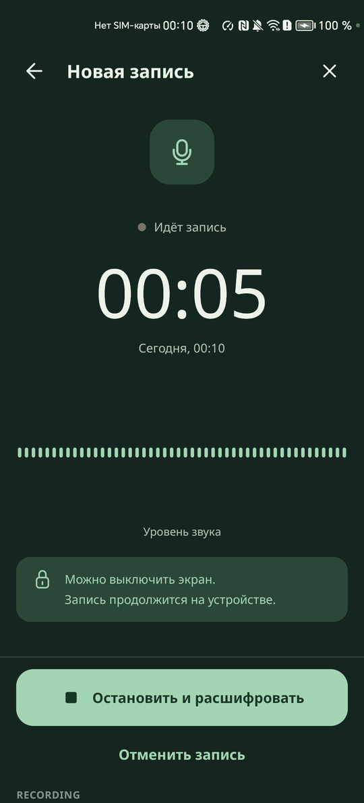

# Импорт аудио и запись

Файл попадает в приложение несколькими путями, и все они ведут к одной обработке. Она запускается сама, подтверждать ничего не нужно.

## Как работает

- Главная называется «Записи». Внизу всегда видны «Импорт аудио» и «Записать»
- «Импорт аудио» открывает системное окно выбора сразу в папке `Download`. Фильтр `audio/*`, `application/ogg`, `video/mp4`, можно выбрать несколько файлов
- «Показать все файлы» открывает то же окно без фильтра
- Раздел «Аудио на устройстве» показывает файлы папки приложения `inbox` без всяких разрешений, а файлы общих папок после разрешения. Оно запрашивается только по нажатию «Показать аудио на устройстве». Нажатие на строку сразу запускает обработку
- «Открыть с помощью» и «Поделиться»: приложение принимает `ACTION_VIEW`, `ACTION_SEND` и `ACTION_SEND_MULTIPLE` и сразу открывает обработку
- Поддержаны MP3, WAV, M4A, OGG, FLAC. Берётся первая звуковая дорожка, обложка и видео пропускаются. FLAC в контейнере Ogg приложение распаковывает само, потому что системный разборщик его не читает
- Файл до 256 МБ сразу копируется во внутреннюю папку задачи, даже если ждёт очереди: права на чужой адрес живут недолго. Больший файл с постоянным доступом читается на месте
- Имя результата берётся из имени файла без расширения, запрещённые в пути символы заменяются на `_`
- На экране обработки кнопка «Запустить транскрибацию» остаётся видимой и безопасной: повторное нажатие только показывает «Обработка уже идёт. Повторный запуск не нужен»
- Импорт не блокируется никогда. Пока копируется языковая модель, Главная показывает «Языковая модель: {x} из {y} МиБ» и «Импорт уже доступен»

### Запись с микрофона

- «Записать» сначала объясняет, зачем нужен микрофон: «Можно записать разговор?». Системный запрос появляется только после «Продолжить»
- Экран «Новая запись»: время, уровень звука, «Остановить и расшифровать», «Отменить запись». Подсказка: «Можно выключить экран. Запись продолжится на устройстве.»
- Запись идёт в службе переднего плана типа `microphone` в WAV 16 кГц моно, память не растёт с длиной
- Если система забрала микрофон, например на время звонка, тишина не пишется, время стоит, а запись продолжается сама. Экран показывает «Микрофон занят, запись ждёт»
- Остановка отправляет файл `Запись <дата> <время>.wav` в обычную обработку
- Отмена записи короче 3 с удаляет её сразу, дольше спрашивает «Удалить эту запись?»

## Как проверить

Перед началом: приложение только что установлено, в `Download` лежат файлы из [маршрута](00-route.md).

1. Откройте приложение - сразу «Записи», без заставки и диалогов, `txt_status` показывает `IDLE`
2. Нажмите «Импорт аудио» - системное окно выбора открывается в `Download`
3. Выберите `dialog1.mp3` - открывается «Обработка», `txt_status` показывает `RUNNING:<STAGE>`
4. Нажмите «Запустить транскрибацию» - появляется «Обработка уже идёт. Повторный запуск не нужен», вторая задача не создаётся
5. Запустите файл командой из [AUTOMATION.md](../AUTOMATION.md) - приложение открывается на обработке этого файла без касаний
6. На Главной нажмите «Показать аудио на устройстве» и разрешите доступ - в разделе «Аудио на устройстве» появляются строки файлов
7. Нажмите «Записать», затем «Продолжить» и разрешите микрофон - идёт время, двигается уровень звука
8. Скажите пару фраз и нажмите «Остановить и расшифровать» - запись уходит в обработку

## Ограничения

- Файл обрабатывается целиком, выбрать фрагмент нельзя
- Распознавания во время записи нет, текст появляется после остановки
- Системное окно выбора - чужое окно. Если на образе его нет, файл доступен из списка «Аудио на устройстве» и через открытие из других приложений
- Запись с настоящего микрофона проверена на Honor, на эмуляторе без звука проверялся только сам путь записи
