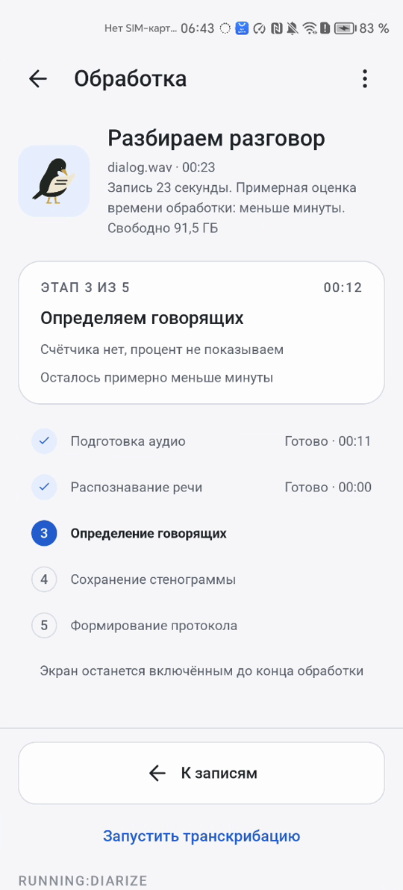

# Экран обработки

Показывает, что происходит на самом деле: этапы, настоящий счётчик, процент этапа, прошедшее время и оценку остатка. Процент есть только там, где есть реальный счётчик.

## Как работает

Рельс этапов сводит стадии конвейера к пяти шагам:

| Этап | Стадии | Счётчик |
|---|---|---|
| «Подготовка аудио» | `IMPORT`, `DECODE`, `VAD`, `LANG_ID` | МиБ файла, позиция в записи, пробные фрагменты |
| «Распознавание речи» | `ASR` | Фрагменты, например «19 из 23 фрагментов» |
| «Определение говорящих» | `DIARIZE` | Окна, например «1 из 3 окон» |
| «Сохранение стенограммы» | `MERGE`, `VALIDATE` | Нет |
| «Формирование протокола» | `LLM` | Окна, идёт уже после сохранения JSON |

- Заголовок «Стенокот слушает.», под ним имя файла и строка предпроверки
- Текущий этап в карточке: «Этап {i} из 5», что делается сейчас, например «Распознаём речь», крупный процент «82 % этапа», полоса и счётчик. У готовых этапов «Готово · {время}»
- Где счётчика нет, процента тоже нет: «Счётчика нет, процент не показываем»
- «Осталось примерно {диапазон}» появляется, только когда оценку есть чем подтвердить: замером устройства или ходом текущей задачи
- Значения внутри этапа обновляются не чаще раза в секунду, смена этапа показывается сразу
- Подсказка внизу: «Экран останется включённым до конца обработки», «Включён режим энергосбережения. Обработка может идти медленнее» или «Продолжаем с сохранённой точки»
- Перегрев: «Пауза: устройство перегрелось», «Продолжим автоматически, когда оно остынет. Готовые этапы сохранены». Работа возобновляется сама, `txt_status` не меняется
- Меню ⋮: «Диагностика» и «Остановить обработку». Остановка спрашивает «Остановить обработку?», затем «Останавливаем обработку: дорабатываем текущий шаг» и «Обработка отменена»
- «К записям» возвращает на Главную, обработка продолжается и видна на карточке задачи с этапом и процентом
- Работа идёт в службе переднего плана и не зависит от экрана. Текущий этап и процент видны в уведомлении, если оно разрешено
- Маскот на экране «дышит» только пока экран виден. Движение выключается в «Настройках» или системной настройкой анимации

После сохранения JSON экран сменяется итогом «Результат готов», «Всё по полочкам.»: длительность, число говорящих, путь к файлу и кнопки «Открыть стенограмму», «Экспорт JSON», «К записям». Пока протокол ещё строится, итог говорит: «Стенограмму можно читать сейчас, протокол ещё формируется».

## Как проверить

Перед началом: Главная, задач в работе нет.

1. Импортируйте `long.mp3` - «Обработка», активна «Подготовка аудио», `txt_status` меняется от `RUNNING:IMPORT` к `RUNNING:LANG_ID`
2. Дождитесь «Распознавание речи» - крупный процент, счётчик фрагментов растёт, `txt_status` показывает `RUNNING:ASR`
3. Подождите ещё немного - появляется «Осталось примерно» с диапазоном
4. Выключите экран на минуту и включите снова - счётчик ушёл вперёд
5. Нажмите «К записям» - на Главной карточка задачи с этапом и процентом
6. Откройте карточку, нажмите ⋮ и «Остановить обработку», затем «Остановить» - «Обработка отменена» и `CANCELLED`. Красного цвета нет
7. Нажмите «Запустить транскрибацию» - задача запускается снова, готовые стадии заново не считаются

## Ограничения

- Общего процента на весь файл нет: длительность стадий несравнима
- Остановка срабатывает на безопасной границе, в диаризации это конец текущего окна
- Пауза из-за перегрева остаётся `RUNNING:<STAGE>`: автоматика не должна считать её сбоем
- Оценка времени на первой записи примерная
