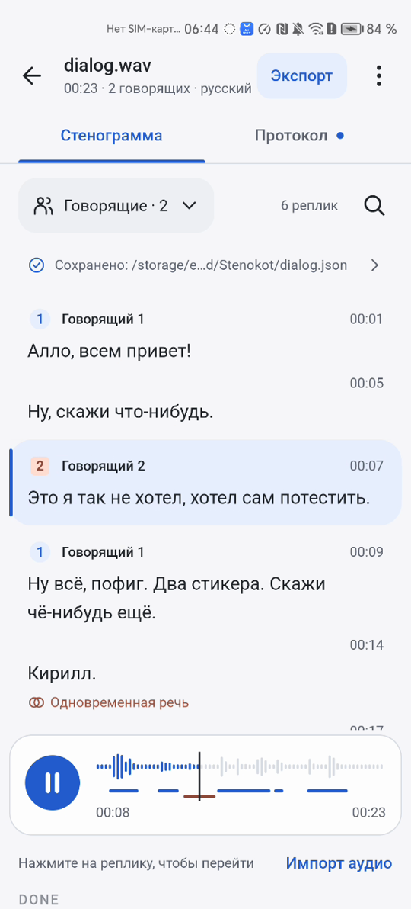

# Стенограмма

Результат доступен сразу после сохранения JSON, раньше протокола. Интерфейс показывает текст модели как есть: не обрезает, не сокращает и не приглаживает.

## Как работает

- Верхняя панель: имя файла, сводка «{длительность} · {N} говорящий · {язык}», заметная кнопка «Экспорт» и меню ⋮
- Вкладки «Стенограмма» и «Протокол». Точка на вкладке протокола значит, что он готов, иначе там значок состояния
- Над списком «Говорящие · N», число реплик, поиск и строка «Сохранено: {путь}», которая открывает сведения о файле
- Реплика читается как абзац: значок говорящего с номером, «Говорящий N», время начала, дословный текст. Продолжение реплики того же говорящего оставляет только время
- Говорящий различается номером, формой значка и цветом. Цвет никогда не работает один, таблица в [брендбуке](../brandbook.md)
- Реплика с наложением показывает метку «Одновременная речь · {говорящий}»: значок и слова, поэтому она читается и без цвета
- Звучащая реплика подсвечена карточкой
- Текст всегда показан целиком, без «Показать ещё». Список ленивый: тысячи реплик не рисуются разом
- Время идёт как `00:04`, от часа `1:24:07`
- Английская запись подписана «Язык определён автоматически: английский», сбой определения «Язык не определён, использован русский»
- Если речи нет, вместо списка маскот, «В файле не обнаружена речь» и «Файл JSON сохранён с пустым списком реплик». В библиотеке такая запись подписана «Речи не найдено», протокол не запускается
- На окне от 840 dp стенограмма и протокол стоят рядом

## Как проверить

Перед началом: `dialog1.mp3` обработан, запись открыта из библиотеки.

1. Посмотрите на список - у каждой реплики значок с номером, «Говорящий N», время и текст
2. Сравните время первой реплики с `start_ms` в `dialog1.json` - значения совпадают с точностью до секунды
3. Сравните текст реплики с полем `text` - текст совпадает символ в символ
4. Откройте запись от `long.mp3` и быстро прокрутите список - прокрутка плавная
5. Импортируйте `silence.wav` - «В файле не обнаружена речь», `txt_status` показывает `DONE`

## Ограничения

- Переименования говорящих и правки текста нет
- Подпись «Говорящий N» относится только к этой записи
