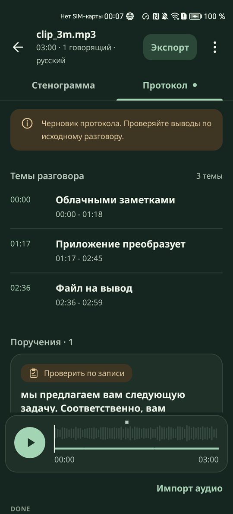

# Темы и протокол

Локальная языковая модель делит запись на темы и находит решения, поручения и открытые вопросы. Пункт протокола ведёт к точной реплике, реплика ведёт к звуку. Текст стенограммы при этом не меняется.

## Как работает

- Модель Qwen3-0.6B Q4_K_M на llama.cpp работает в отдельном процессе `:llm` и стартует через 3 секунды после записи JSON
- Модель получает окно реплик с номерами и отвечает только темой и строками вида `D 12`, `A 13`, `Q 14`: решение, поручение, открытый вопрос. Не больше трёх пунктов на окно
- Грамматика GBNF строится на лету из настоящих номеров реплик окна. Сослаться на несуществующую реплику невозможно на уровне выбора токенов
- Текст пункта, говорящего и время копирует код. Ни одно слово модели, кроме темы, в протокол не попадает
- Вид пункта подтверждается словами реплики: решение и поручение прямым оборотом, вопрос знаком вопроса и отсутствием ответа. Лучше пропустить пункт, чем показать ложный
- Тема проверяется по основам слов окна и по числам. Тема, которая не прошла проверку, заменяется интервалом: «Фрагмент {время}»
- Окна с неясным алфавитом и окна с редкой речью пропускаются. Окна идут так, что любая начальная часть покрывает запись равномерно
- Ответ по окну сразу попадает в журнал, поэтому смерть процесса теряет не больше одного окна
- Вверху вкладки: «Черновик протокола. Проверяйте выводы по исходному разговору.» Ниже «Темы разговора» с интервалами, затем «Решения · N», «Поручения · N», «Открытые вопросы · N»
- Пункт помечен «Проверить по записи» и «Источник · {время}». Экран пункта показывает «Черновик · Нужна проверка», «Основание в разговоре», цитату и «Перейти к реплике»
- Нажатие на тему открывает «Стенограмму» на её первой реплике

| Баннер на результате | `LlmStatus` | Что значит |
|---|---|---|
| «Скоро начнём готовить протокол», «Протокол формируется: готово окон {i} из {n}» | | Модель загружается или работает |
| «Ждём модель: {x} из {y} МиБ» | | JSON готов, копия файла модели ещё идёт |
| «Протокол готов» | `APPLIED` | Обработаны все окна |
| «Протокол частичный: {x} из {n}» | `PARTIAL` | Обработана часть окон, вкладка показывает «Обработаны интервалы: ...» |
| «Протокол отложен до простоя» | `DEFERRED` | Новый файл вытеснил модель, один повтор после 30 секунд простоя |
| «Протокол пропущен: лимит времени» | `SKIPPED_BY_BUDGET` | Не успело ни одно окно, один повтор |
| «Протокол пропущен из-за памяти» | `SKIPPED_LOW_MEMORY` | Свободно меньше 650 МиБ |
| «Не удалось сформировать протокол: ошибка LLM» | `FAILED` | Модель завершилась с ошибкой, `txt_status` показывает `DONE_LLM_FAILED` |
| «Не удалось сформировать протокол: нет модели» | `FAILED` | Файл модели недоступен или не прошёл проверку хэша |
| «Протокол остановлен» | `CANCELLED_BY_NEW_JOB` | Протокол остановил пользователь, повтора не будет |

Пределы: не больше 60 окон на запись, 45 минут на стадию, 180 секунд на окно. В библиотеке те же состояния подписаны «Протокол готов», «Протокол частичный», «Протокол отложен», «Протокол остановлен», «Протокол пропущен», «Протокол не создан».

## Как проверить

Перед началом: `dialog1.mp3` обработан, `txt_status` показывает `DONE`.

1. Откройте вкладку «Протокол» - видны пометка о черновике, темы с интервалами и пункты, если модель их нашла
2. Нажмите пункт - экран пункта с цитатой. Сравните цитату с репликой в «Стенограмме» - текст совпадает дословно
3. Нажмите «Перейти к реплике» - открывается «Стенограмма» на этой реплике
4. Выполните `adb pull /sdcard/Download/Stenokot/meta/dialog1.protocol.json` - у раздела есть `first_utterance`, у пункта `kind`, `utterance`, `speaker_id`, `start_ms`, `text`
5. Импортируйте файл и сразу после `RUNNING:LLM` импортируйте другой - новый файл идёт в работу, первый протокол «Протокол отложен до простоя»
6. Подождите 30 секунд простоя после конца второго файла - протокол первого запускается снова

## Ограничения

- Модель маленькая, пунктов мало, около одного на запись, и пункт цитирует реплику целиком
- Ложные пункты на последней сборке не подсчитаны, точность и полнота не измерены. Поэтому протокол всегда черновик
- Английский протокол проверяли только с прежней английской моделью: темы были слабыми, пунктов не нашлось
- На записи 57 минут на Honor обработано 33 окна из 60 за 882 с, статус `PARTIAL`
- Если проверка заканчивается на JSON, протокола в этом прогоне может не быть
- Кнопки ручного перезапуска протокола нет
