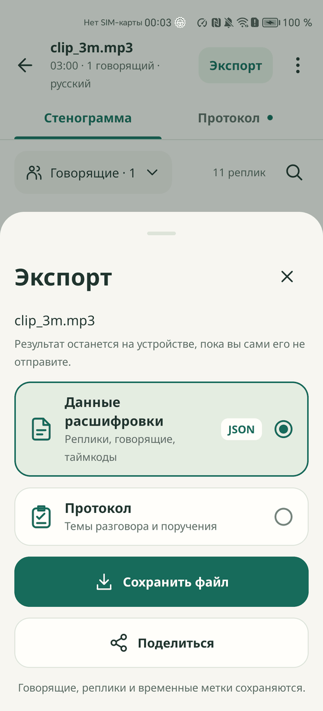
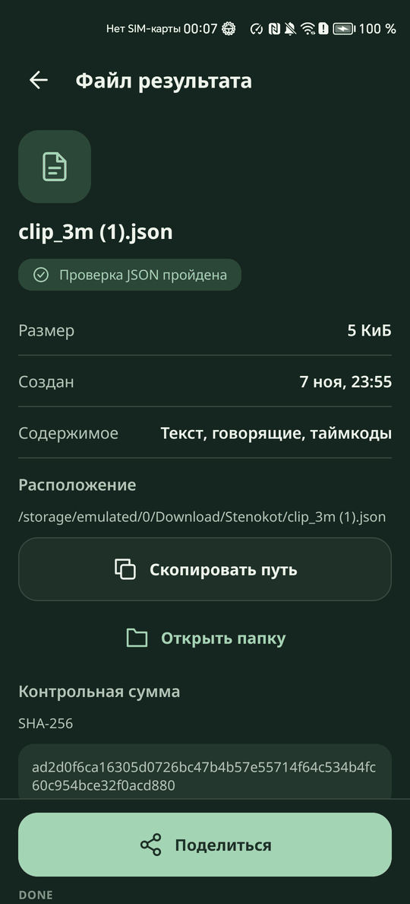

# Экспорт

JSON появляется сам. Экспорт нужен, чтобы сохранить копию в другое место или отправить её, и его сбой не закрывает стенограмму.

  
  

## Как работает

- Автоматический путь: `Download/Stenokot/<имя>.json`. При сбое записи туда тот же файл сохраняется в `Android/data/ru.stenokot.app/files/export/`, а на экране виден настоящий путь: «Сохранено в папке приложения: {путь}»
- Кнопка «Экспорт» в верхней панели результата и «Экспорт JSON» на итоге обработки сразу открывают системное окно сохранения с именем `<имя>.json`. Байты совпадают с автоматическим файлом, запись идёт режимом `wt`, поэтому старый хвост не остаётся
- Меню ⋮, «Экспорт результата» открывает лист «Экспорт»: «Данные расшифровки» в JSON или «Протокол», затем «Сохранить файл» или «Поделиться». Протокол сохраняется как `<имя>.protocol.json`. Пока его нет: «Протокол для этой записи ещё не готов»
- Строка «Сохранено: {путь}» открывает «Файл результата»: имя, «Проверка JSON пройдена», размер, время создания, содержимое, путь, SHA-256 и действия «Скопировать путь», «Открыть папку», «Поделиться»
- «Экспорт служебных данных» в диагностике сохраняет `<имя>.metadata.json`. В контракт служебные файлы не попадают
- При сбое ручного экспорта видно «Результат готов, но файл не сохранён», «Стенограмма осталась в приложении. Выберите другое место для файла» и кнопка «Повторить экспорт»

## Как проверить

Перед началом: запись `dialog1.mp3` открыта на вкладке «Стенограмма».

1. Нажмите строку «Сохранено: ...» - «Файл результата», путь `Download/Stenokot/dialog1.json`, размер, время и «Проверка JSON пройдена»
2. Нажмите «Скопировать путь» и вставьте текст в любое поле - вставляется полный путь
3. Вернитесь и нажмите «Экспорт», сохраните файл под другим именем - файл сохранён
4. Выполните `shasum -a 256` для обоих файлов - хэши равны и совпадают с SHA-256 на «Файл результата»
5. Нажмите «Поделиться» - открывается системное окно выбора приложения
6. Нажмите «Открыть папку» - открывается папка с файлом или сообщение «Папку нечем открыть на этом устройстве»
7. Нажмите «Экспорт», затем отмените окно сохранения - состояние экрана не меняется, сообщений нет

## Ограничения

- Отключить автоматический файл нельзя
- «Открыть папку» зависит от файлового приложения образа
- Экспорта в другие форматы нет
