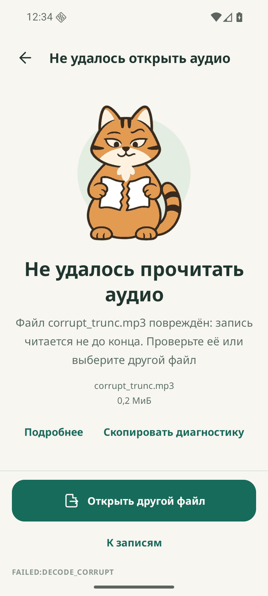

# Ошибки

Каждая ошибка - понятная фраза, причина и одно главное действие. Код и подробности спрятаны в «Подробнее» и «Скопировать диагностику». Модальных окон нет, приложение остаётся живым.

## Как работает

| Ситуация | Заголовок | Главное действие | Код |
|---|---|---|---|
| Мало места | «Освободите минимум {x}» | «Повторить проверку» | `STORAGE_LOW` |
| Система остановила обработку из-за памяти | «Закройте другие приложения или выберите короткую запись» | «Повторить безопасно» | `LOW_MEMORY` |
| Повреждённый или обрезанный файл | «Не удалось прочитать аудио» | «Открыть другой файл» | `DECODE_CORRUPT` |
| Не аудио, нет декодера | «Формат не поддерживается» | «Открыть другой файл» | `DECODE_UNSUPPORTED_FORMAT` |
| Файл не читается, нет доступа | «Не удалось прочитать файл» | «Импорт аудио» | `IMPORT_READ_FAILED`, `IMPORT_NO_PERMISSION` |
| Модель речи не загрузилась | «Модель не прошла проверку целостности» | «Открыть модели» | `MODEL_LOAD_FAILED` |
| Результат не прошёл проверку | «Ошибка обработки» | «Запустить транскрибацию» | `CONTRACT_INVALID` |
| Прерывание | «Продолжим с места остановки» | «Продолжить» | `INTERRUPTED`, `FGS_TIMEOUT` |
| Сбой языковой модели | «Стенограмма готова, протокол не создан» на вкладке протокола | «Открыть стенограмму» | `DONE_LLM_FAILED` |
| Сбой экспорта | «Результат готов, но файл не сохранён» | «Повторить экспорт» | `EXPORT_FAILED` в диагностике |

- Красный цвет только там, где JSON или файл экспорта не получен. Сбой протокола показывается предупреждением, отмена ошибкой не считается
- Сбой языковой модели никогда не выглядит как сбой расшифровки: стенограмма открыта, `txt_status` показывает `DONE_LLM_FAILED`
- Нет речи - не сбой: файл `{"transcript":[]}` записан, `txt_status` показывает `DONE`, на результате «В файле не обнаружена речь»
- Файл модели протокола, не прошедший проверку хэша, копируется из APK заново. Если не помогло, Главная показывает «Языковая модель недоступна. Протокола не будет», а стенограмма работает как обычно
- Нехватка памяти перед стадией только предупреждает. Ошибкой становится остановка процесса системой
- `txt_status` всегда показывает `FAILED:<CODE>`, поэтому автоматика видит точную причину
- Диагностика не содержит аудио, текста реплик, имён файлов и путей

## Как проверить

Перед началом: Главная, в `Download` лежат `broken.mp3`, `note.txt`, `silence.wav`.

1. Импортируйте `broken.mp3` - «Не удалось прочитать аудио», кнопка «Открыть другой файл», `FAILED:DECODE_CORRUPT`
2. Нажмите «Подробнее» - видны код, стадия и задача
3. Нажмите «Скопировать диагностику» и вставьте текст - имени файла в нём нет
4. Нажмите «Открыть другой файл» - открывается системное окно выбора
5. Нажмите «Показать все файлы» и выберите `note.txt` - «Формат не поддерживается», `FAILED:DECODE_UNSUPPORTED_FORMAT`, приложение живо
6. Заполните память устройства и импортируйте `long.mp3` - «Освободите минимум {x}», `FAILED:STORAGE_LOW`
7. Освободите место и нажмите «Повторить проверку» - обработка начинается

## Ограничения

- Причина смерти основного процесса известна не всегда: без записи системы прерывание показывается как `FAILED:INTERRUPTED`
- Нехватку памяти на эмуляторе трудно вызвать точно, поведение на стенде проверки не измерено
- Шаги 6 и 7 на последней сборке не прогонялись
