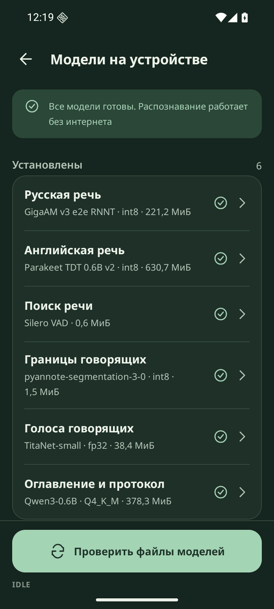

# Модели, приватность и диагностика

Экраны показывают доказательства, а не обещания: что сети нет, какие модели работают и совпадают ли их файлы со сборкой, что случилось с конкретной записью. Вход: «Настройки» на Главной или строка «Модели готовы».

## Как работает

- «Модели на устройстве»: «Русская речь», «Английская речь», «Поиск речи», «Границы говорящих», «Голоса говорящих», «Оглавление и протокол» с названием, форматом весов и размером. Перечень хэшей вшит в сборку из `config/models.lock`
- «Проверить файлы моделей» читает все файлы моделей блоками и сверяет их с перечнем. Итог: «Все файлы совпали с контрольными суммами сборки» или «Файлы отсутствуют или изменены: ...»
- «Сведения о модели»: назначение, размер, формат весов, лицензия, целостность файла и SHA-256 основного файла
- «Приватность и разрешения»: «Разрешения на интернет нет. Всё работает на устройстве», `INTERNET` и `ACCESS_NETWORK_STATE` «нет в пакете», «Проверено по установленному пакету {пакет}, версия {версия}». Разрешения читаются у установленного пакета, а не из манифеста в репозитории
- «Разрешения»: микрофон, уведомления, аудиофайлы с текущим состоянием и технический список имён
- «Диагностика записи» и «Диагностика» в меню записи: длительность, время обработки, «RTF до сохранения JSON» и «RTF с протоколом», пик памяти, устройство, потоки, статус протокола, токены языковой модели, время этапов, проверка контракта, путь и SHA-256 файла JSON. Чего не мерили, подписано «не измерено»
- «Скопировать диагностику» копирует JSON с версиями, устройством, хэшами моделей, стадиями, предупреждениями и ошибками. Аудио, текста реплик, имён файлов и путей в нём нет
- «Экспорт служебных данных» сохраняет `metadata.json` записи
- «О приложении»: версия, пакет и «Лицензии компонентов» с текстами лицензий шрифта, моделей и библиотек, они доступны без сети

## Как проверить

Перед началом: `dialog1.mp3` обработан.

1. Откройте «Настройки», «Приватность и разрешения» - `INTERNET` и `ACCESS_NETWORK_STATE` «нет в пакете»
2. Откройте «Модели на устройстве» и нажмите «Проверить файлы моделей» - идёт счётчик МиБ, затем «Все файлы совпали с контрольными суммами сборки»
3. Откройте сведения любой модели и сравните SHA-256 с [config/models.lock](../../config/models.lock) - значения совпадают
4. Откройте запись, ⋮, «Диагностика» - время обработки, оба `RTF` и этапы заполнены
5. Выполните `shasum -a 256 dialog1.json` на компьютере - хэш совпадает с показанным
6. Нажмите «Скопировать диагностику» и вставьте текст - текста реплик и имени файла нет
7. Выполните `aapt2 dump permissions <apk>` - вывод подтверждает экран, подробно в [19. Доказательство работы без сети](19-offline-proof.md)

## Ограничения

- Пик памяти на экране относится к основному процессу. В `metadata.json` записан наибольший из пиков основного процесса и `:llm`
- Проверка файлов моделей идёт только по кнопке: при каждом запуске сотни мегабайт не перечитываются
