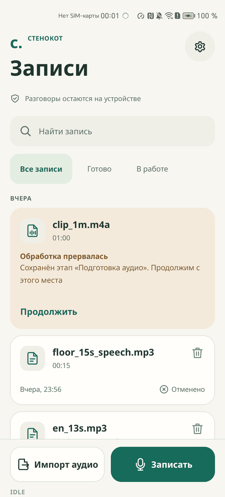
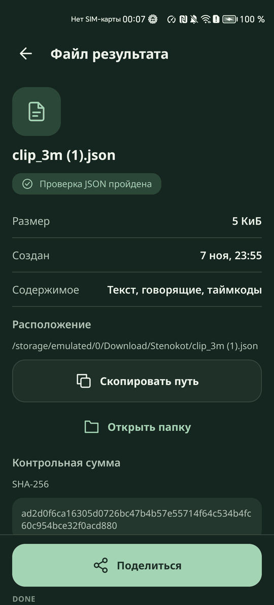
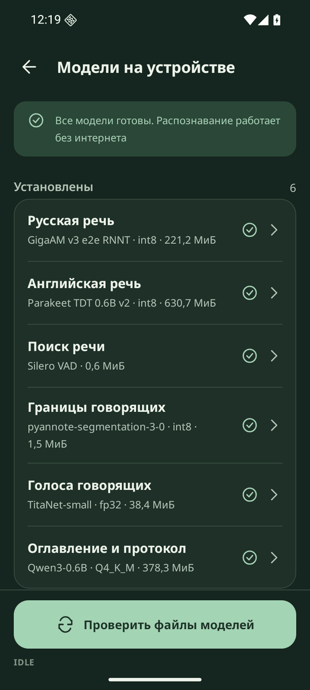

# Любое устройство

Интерфейс не зависит от размера экрана, шрифта и темы. Каждый экран отвечает на три вопроса: где я, что происходит, что делать дальше.

## Как работает

- Раскладка выбирается по классу ширины и высоты окна. Узкое окно - одна колонка. Среднее - колонка по центру шириной до 640 dp. От 840 dp или телефон в альбомной ориентации - две панели на Главной, обработке, ошибке и диагностике, а на результате стенограмма рядом с протоколом
- На низком окне плеер и сведения о файле результата уходят в боковую колонку
- На коротком экране и при крупном шрифте второстепенное уходит вниз, закреплённым остаётся главное. Подпись вкладки уменьшается ровно настолько, чтобы слово не разорвалось
- Вокруг текста нет фиксированных высот, строки растут вместе со шрифтом. Горизонтальной прокрутки нет
- Приложение работает от края до края, учитывает системные панели, вырез и клавиатуру. Поворот сохраняет экран
- Тема: «Как в системе», «Светлое», «Тёмное» в «Настройках», «Оформление». Тёмная тема доведена так же, как светлая
- Цели нажатия не меньше 48 dp. TalkBack читает строки целиком, маскот пропускает. Строка `txt_status` есть в дереве доступности на каждом экране и получает русское описание, например «Состояние: идёт этап Распознавание речи»
- Движение короткое и только на смену состояния. Исключение одно: маскот на экране обработки слегка «дышит», пока экран виден. Его выключают «Анимации маскота» в настройках и системное отключение анимации
- Шрифт Noto Sans встроен в приложение, сети он не требует
- 63 векторных значка на одной сетке 24 dp

## Что проверено

Проверка вёрстки 2026-11-08: UiAutomator с реальными границами элементов, 715 снимков на 360x800, 320x568, 800x1280 и Honor, светлая и тёмная тема. Итог после исправлений: 0 наложений, 0 обрезанных подписей, 0 нарушений безопасной зоны. Найденные по ходу проблемы исправлены: область касания вкладок, перенос кнопок итога, заголовки листов, дубль значка.

  
  
  

## Как проверить

Перед началом: запись `dialog1.mp3` обработана.

1. Включите шрифт 200 % в настройках системы - текст не обрезан, кнопки доступны
2. Поверните устройство на Главной и на результате - состояние сохраняется
3. Запустите приложение на эмуляторе 1280x800 - на широком окне панели стоят рядом
4. В «Настройках», «Оформление» выберите «Тёмное» - цвета меняются сразу, значки говорящих остаются с номером и формой
5. Включите TalkBack и пройдите по Главной - маскот пропускается, строки читаются целиком
6. Выключите «Анимации маскота» - на экране обработки маскот стоит неподвижно

## Ограничения

- Только `arm64-v8a`
- Интерфейс только на русском
- На планшете 800x1280 в портрете окно уже 840 dp, поэтому там одна колонка по центру
